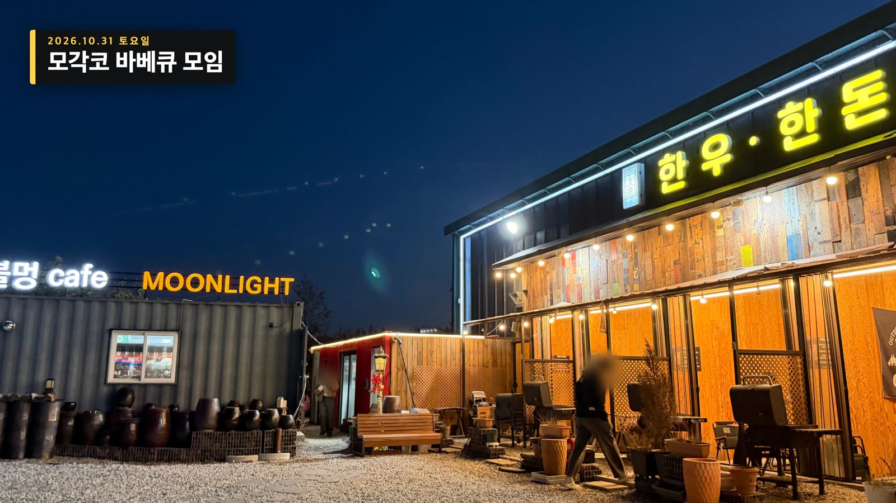
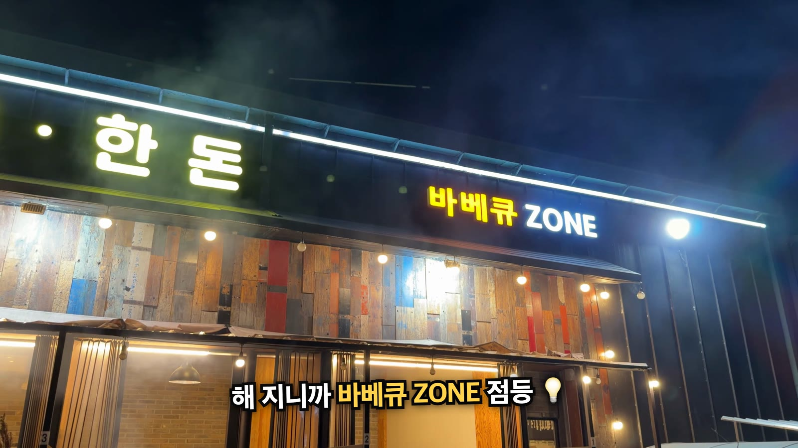
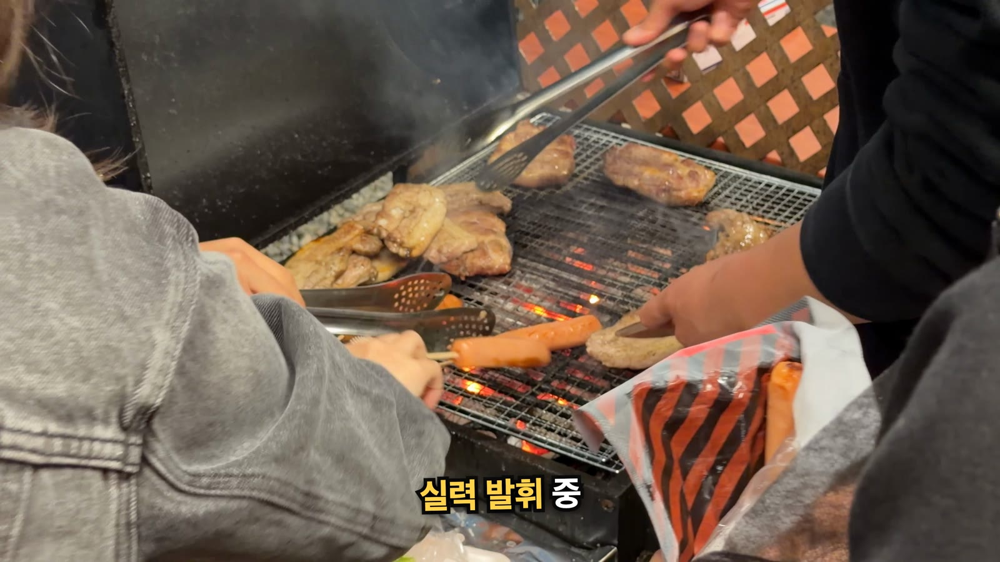
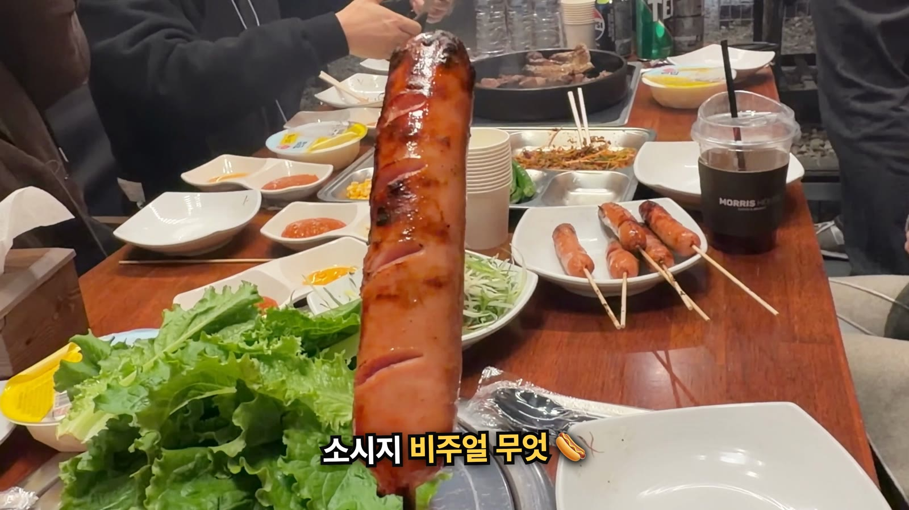
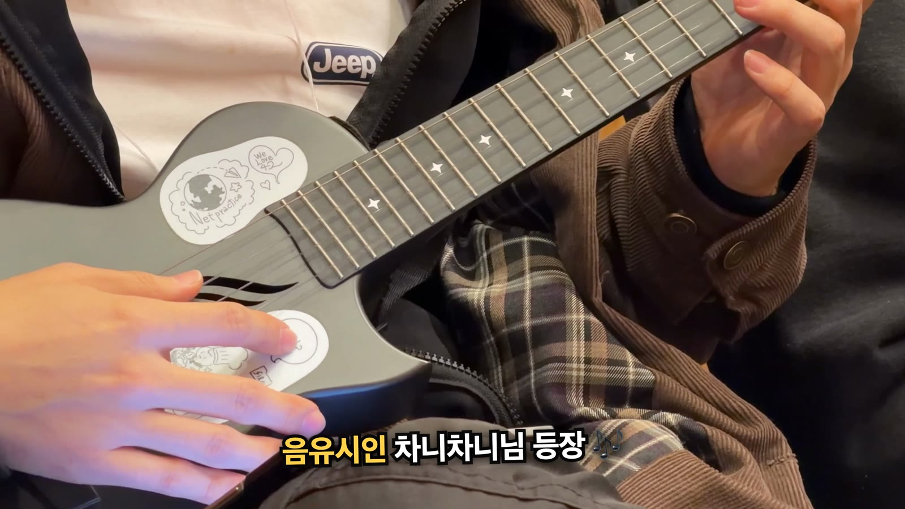
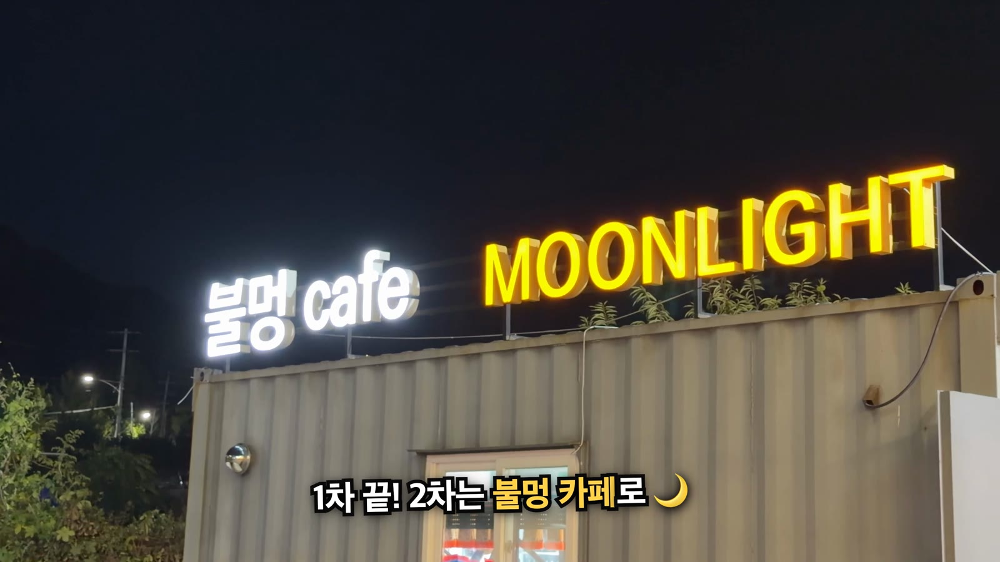
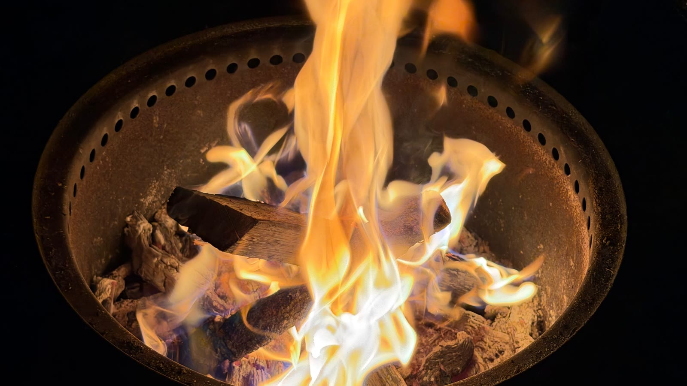
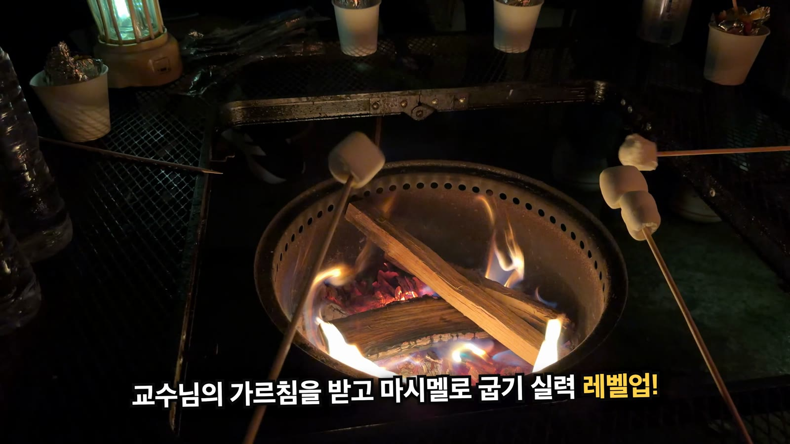
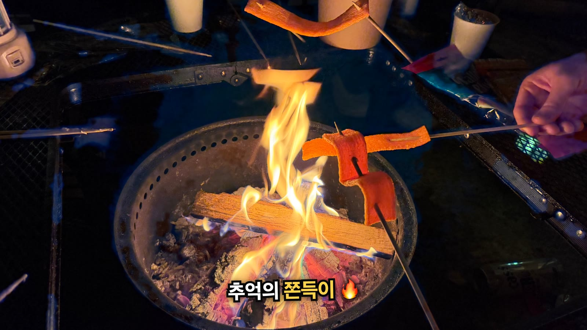
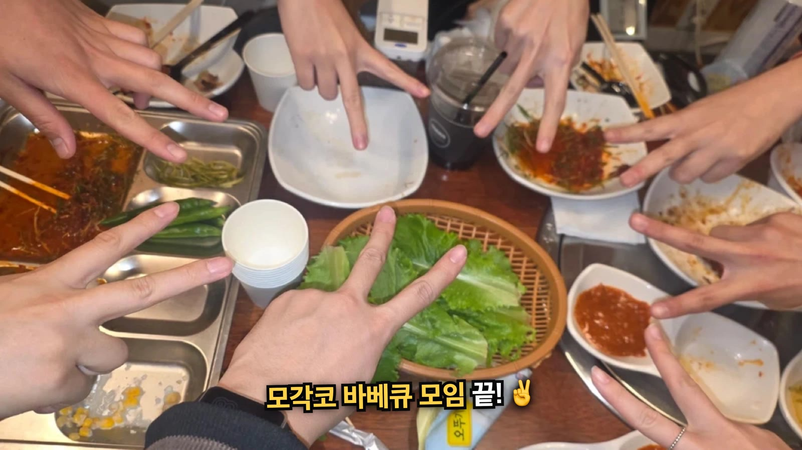

10월 31일 토요일, 모여서 각자 코딩하는 모각코 모임이 끝나고 다 같이 바베큐를 먹으러 갔습니다. 1차는 숯불 바베큐, 2차는 같은 가게의 불멍 카페에서 마시멜로와 쫀득이를 구웠습니다. 중간에는 우쿨렐레 즉석 라이브도 있었습니다.

그날 찍은 영상과 사진으로 2분 16초짜리 후기 영상을 만들었습니다. 같이 간 분들 얼굴은 나오지 않게 손, 음식, 불, 간판 위주로 골랐습니다.

  <iframe src="https://www.youtube.com/embed/2gO0yJ3ljV4"
    title="모각코 바베큐 모임 🔥 고기 굽고, 우쿨렐레 듣고, 불멍하며 마시멜로까지"
    loading="lazy" allowfullscreen
    style="position:absolute;top:0;left:0;width:100%;height:100%;border:0;"
    allow="accelerometer; autoplay; clipboard-write; encrypted-media; gyroscope; picture-in-picture"></iframe>

*모각코 바베큐 모임 후기 영상 (2분 16초)*

## 한눈에 보기 {#tldr}

| 항목 | 내용 |
|---|---|
| 날짜 | 2026년 10월 31일 토요일, 저녁 6시쯤부터 |
| 장소 | 불멍카페 문라이트 & 바베큐 |
| 1차 | 바베큐존에서 숯불 바베큐 |
| 2차 | 같은 가게 불멍 카페에서 마시멜로와 쫀득이 굽기 |
| 특별 공연 | 음유시인 차니차니님의 우쿨렐레 즉석 라이브 |

## 1차. 바베큐존 {#bbq}

해가 막 진 저녁 6시쯤 도착했습니다. 컨테이너 건물에 「불멍 cafe MOONLIGHT」 간판과 「한우·한돈」 간판이 나란히 붙어 있습니다.

{: w="1600" h="900" }
_해 질 녘 도착. 앞에 서 있던 사람은 흐리게 지웠다_

자리를 잡고 테이블 위 스피커 조명을 켠 다음, 쇼케이스에서 고기를 고르고 냉장고에서 음료를 골라 계산했습니다. 그 사이 해가 완전히 지면서 「바베큐 ZONE」 간판에 불이 들어왔습니다.

{: w="1600" h="900" }
_해가 지니 바베큐 ZONE 간판에 불이 들어왔다_

고기는 주로 **우니님**이 구웠습니다. 바베큐 전문가처럼 정말 잘 구웠습니다.

{: w="1600" h="900" }
_바베큐 전문가 우니님의 석쇠_

꼬치에 꽂힌 소시지는 크기가 압도적이었습니다. 다 익은 것은 가위로 먹기 좋게 잘라 나눴습니다.

{: w="1600" h="900" }
_소시지 크기가 반찬 접시만 하다_

## 음유시인의 우쿨렐레 라이브 {#ukulele}

저녁 7시 반쯤 **차니차니님**이 우쿨렐레를 꺼냈습니다. 본인을 「음유시인」이라고 부르는 분인데, 그 자리에서 즉석 라이브를 들려줬습니다.

{: w="1600" h="900" }
_음유시인 차니차니님의 즉석 라이브_

## 2차. 불멍 카페 {#bulmeong}

1차를 마치고 같은 가게의 불멍 카페로 자리를 옮겼습니다. 바베큐존 바로 옆이라 걸어서 금방입니다.

{: w="1600" h="900" }
_2차는 불멍 카페. 밤에 보니 간판이 더 예쁘다_

화로 테이블 가운데에서 장작이 탑니다. 불꽃에 파란색과 초록색이 섞여 올라와서 보는 재미가 있었습니다.

{: w="1600" h="900" }
_불멍. 보고 있으면 시간이 금방 간다_

## 마시멜로 교수님 {#marshmallow}

불멍 카페의 하이라이트는 마시멜로 굽기였습니다. 우리 중에 마시멜로를 유난히 잘 굽는 **포도님**이 있어서, 다들 「마시멜로 교수님」이라고 불렀습니다. 교수님께 굽는 요령을 배운 다음 다 같이 꼬챙이를 들고 실습했습니다.

{: w="1600" h="900" }
_교수님의 가르침을 받고 마시멜로 굽기 실력 레벨업_

## 마시멜로 다음은 쫀득이 {#jjondeugi}

마시멜로 다음에는 추억의 간식 쫀득이를 구웠습니다.

{: w="1600" h="900" }
_추억의 쫀득이_

영상의 마지막은 바베큐 상에서 다 같이 찍은 손 브이 사진으로 장식했습니다.

{: w="1600" h="900" }
_모각코 바베큐 모임 끝_

## 영상은 이렇게 만들었습니다 {#video}

영상은 Claude Code와 직접 만든 편집 도구로 만들었습니다. 컷은 배경음악의 마디에 맞춰 바꾸고, 원래 소리에는 대화가 섞여 있어서 전부 끄고 음악만 깔았습니다. 음악은 Pixabay의 무료 음원 [Heavy Funk Groove](https://pixabay.com/music/funk-heavy-funk-groove-586249/){:target="_blank" rel="noopener"}(ElectroAnimals)입니다.

같이 간 분들 얼굴이 나오지 않게 하는 데 가장 손이 많이 갔습니다. 얼굴 검출기가 화면 위 끝에 반쯤 걸린 얼굴을 자꾸 놓쳐서, 완성본을 몇 번이고 다시 훑어서 찾아냈습니다. 만든 과정은 개발 블로그 기술노트에 따로 정리했습니다.

- [얼굴이 안 나오는 모임 후기 영상 만들기](https://dev.junho85.pe.kr/2026/11/01/mogakco-bbq-video-no-faces.html){:target="_blank" rel="noopener"}
