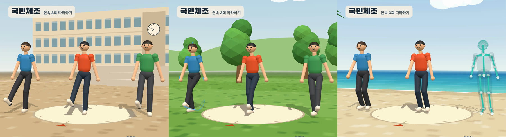

몸이 여기저기 뻐근했습니다. 특히 목이 계속 안 좋았습니다. 그런데 요즘 매일 자기 전에 국민체조를 세 번 연속으로 하고 잡니다. 그렇게 지내고 나서 몸이 많이 좋아졌습니다. 목도 많이 편해졌습니다.

세 번 하는 데 15분이면 됩니다. 유튜브 영상을 틀어 놓고 따라 합니다. 따라 하는 영상은 직접 만들었습니다.

  <iframe src="https://www.youtube.com/embed/lokzQ_UGkvU"
    title="국민체조 연속 3회 따라하기"
    loading="lazy" allowfullscreen
    style="position:absolute;top:0;left:0;width:100%;height:100%;border:0;"
    allow="accelerometer; autoplay; clipboard-write; encrypted-media; gyroscope; picture-in-picture"></iframe>

*국민체조 연속 3회 따라하기 (14분 44초)*

> 제 경험을 적은 글입니다. 통증이 심하거나 오래가면 병원에서 진료를 먼저 받으세요.
{: .prompt-info }

## 한눈에 보기 {#tldr}

| 항목 | 내용 |
|---|---|
| 언제 | 밤에 자기 전 |
| 얼마나 | 국민체조 세 번 연속, 약 15분 |
| 어떻게 | 유튜브 영상을 틀어 놓고 구령에 맞춰 따라 하기 |
| 달라진 것 | 여기저기 뻐근하던 몸이 많이 풀렸고, 특히 목이 많이 좋아졌다 |

## 목이 계속 안 좋았습니다 {#neck}

목은 오래된 고민입니다. 2024년 9월에는 팔이 아파서 도수치료와 체외충격파 치료를 받으러 갔습니다. 그때 엑스레이를 찍었더니 목이 「역 C자」라는 이야기를 들었습니다. 목을 왼쪽으로 돌리거나 기울이는 것도 오른쪽보다 잘 안 됐습니다. 그 전에도 목 때문에 도수치료를 받은 적이 있습니다.

- [오랜만에 도수치료와 체외충격파 치료 (준호씨의 웹로그, 2024-09-15)](https://talk.junho85.pe.kr/133){:target="_blank" rel="noopener"}

그 뒤로도 몸 여기저기가 뻐근했고, 목은 특히 안 좋았습니다.

## 왜 국민체조였나 {#why}

국민체조는 몸 전체를 한 번씩 다 움직입니다. 열두 가지 동작이 있습니다.

1. 숨쉬기
2. 다리운동
3. 팔운동
4. 목운동
5. 가슴운동
6. 옆구리운동
7. 등배운동
8. 몸통운동
9. 온몸운동
10. 뜀뛰기
11. 팔다리운동
12. 숨고르기

1번부터 10번까지를 두 번 하고, 팔다리운동과 숨고르기로 끝납니다. 한 번에 5분이 안 걸립니다.

제게 좋았던 점은 이렇습니다.

- **목운동이 들어 있습니다.** 목을 앞뒤, 옆으로 굽히고 크게 돌립니다. 따로 목 스트레칭을 챙기지 않아도 매일 하게 됩니다
- **어깨와 등, 허리를 다 씁니다.** 팔을 크게 돌리고, 가슴을 펴고, 몸을 숙였다 젖히고, 비틉니다
- **구령이 있어서 생각할 게 없습니다.** 음악과 「하나, 둘」 구령을 따라가기만 하면 됩니다
- **도구도 자리도 거의 필요 없습니다.** 팔을 벌릴 만한 공간만 있으면 됩니다

## 자기 전에 세 번 {#routine}

매일 밤 자기 전에 영상을 틀어 놓고 세 번을 이어서 하고 잡니다. 그렇게 지내다 보니 여기저기 뻐근하던 것이 많이 줄었고, 목이 특히 많이 좋아졌습니다.

## 따라 하는 영상을 직접 만들었습니다 {#video}

원래는 유튜브에 있는 국민체조 3회 연속 영상을 틀어 놓고 했습니다. 그 영상을 3D 캐릭터가 체조하는 영상으로 직접 만들어 바꾸고, 유튜브에 올렸습니다.

{: w="1800" h="488" }
_1회는 학교 운동장, 2회는 잔디밭, 3회는 해변에서 한다_

- 캐릭터 세 사람이 함께 합니다. 1회는 학교 운동장, 2회는 잔디밭, 3회는 해변입니다
- 화면 오른쪽에 지금 하는 동작의 이름과 설명, 다음 동작이 나옵니다
- 동작마다 잘 보이는 쪽으로 카메라가 돌아갑니다. 옆에서 볼 때는 왼쪽 아래에 정면 모습을 작게 띄웁니다
- 2회에는 손과 발이 지나간 자리가 선으로 남고, 3회에는 한 사람이 뼈대 모습으로 바뀌어 관절이 어떻게 움직이는지 보입니다

영상 구간은 이렇습니다.

| 시각 | 구간 |
|---|---|
| 0:00 | 1회 준비 (학교 운동장) |
| 0:18 | 1회 숨쉬기 ~ 뜀뛰기 |
| 4:23 | 1회 팔다리운동, 숨고르기 |
| 4:57 | 2회 준비 (잔디밭) |
| 9:16 | 2회 팔다리운동, 숨고르기 |
| 9:49 | 3회 준비 (해변) |
| 14:08 | 3회 팔다리운동, 숨고르기 |

영상을 어떻게 만들었는지는 기술노트에 따로 정리했습니다.

- [국민체조 따라하기 영상 직접 만들기 (기술노트)](https://dev.junho85.pe.kr/2026/10/27/gukmin-chejo-3x-video-making.html){:target="_blank" rel="noopener"}

## 참고 자료 {#references}

- [국민체조 연속 3회 따라하기 (유튜브)](https://youtu.be/lokzQ_UGkvU){:target="_blank" rel="noopener"}
- [오랜만에 도수치료와 체외충격파 치료 (준호씨의 웹로그)](https://talk.junho85.pe.kr/133){:target="_blank" rel="noopener"}
